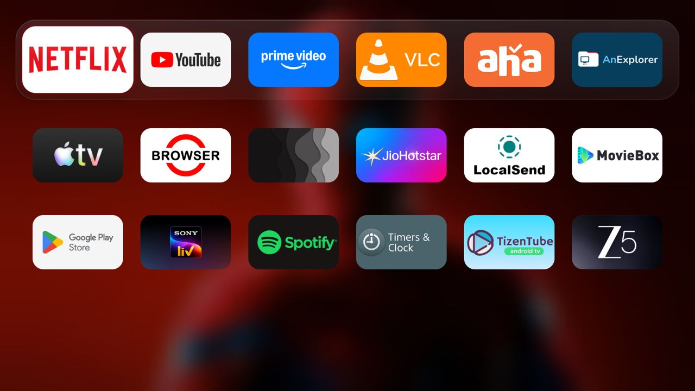
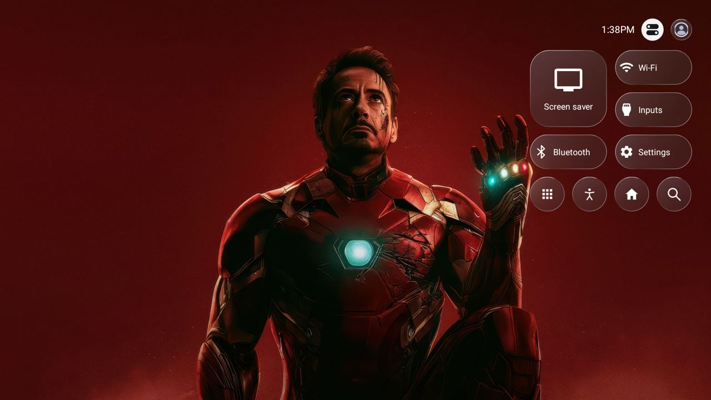

# LiquiTvOs

A tvOS-inspired Liquid Glass launcher fork of [CleanYourTV](https://github.com/Gathin23/cleanyourtv), by [purnavikas](https://github.com/purnavikas). It is a full launcher restyle, not a config-only theme or an Apple product.

Tested on Sony BRAVIA 4K VH22, Android TV 12 (SDK 31), 1920 × 1080 UI. Other televisions and Android versions have not been verified. Minimum Android version remains 8.0 (SDK 26).

## Features

- Six-column app grid and a rounded glass dock with proportional focus scaling.
- Down expands the dock into the full grid and softly blurs the wallpaper. Up on the first row returns to the compact Home; another Up selects time/profile. OK opens Control Center.
- Floating glass controls for the TV's settings, inputs, network, Bluetooth pairing, accessibility, search, screen saver and app library. Native screen availability depends on firmware.
- Circular launcher-profile selector with account initials, selected checkmark and Add User through Android's account chooser.
- Local Pictures wallpaper shuffle, one-minute rotation and automatic rescanning for added photos; no Mac or cloud sync required.
- Home dock stays hidden while Control Center, Profile or their option popups are open. Cached wallpaper blur is sampled inside the glass while the surrounding wallpaper stays sharp.
- Reduced-motion support, existing launcher app management and native app opening retained.

## Real-TV screenshots





The photographs shown are personal wallpaper choices, not bundled or licensed as part of this project. Add your own images. Screenshots show the design on the tested television; installed apps differ by device.

## Build and try safely

Use JDK 17, Android SDK platform 34 and build-tools 34.0.0. From `launcher/`:

```sh
./gradlew --no-daemon \
  -PlauncherApplicationId=com.gathin.tvhome.liquidpreview \
  -PlauncherPreview=true \
  testReleaseUnitTest lintRelease assembleRelease
```

The result is `app/build/outputs/apk/release/app-release.apk`. This preview has no HOME category. Install it as an update to preserve an existing LiquiTvOs installation:

```sh
adb -s TV_SERIAL install -r app/build/outputs/apk/release/app-release.apk
adb -s TV_SERIAL shell am start -n com.gathin.tvhome.liquidpreview/com.gathin.tvhome.MainActivity
```

After launching once, copy `docs/liquitvos/config.json` from the repository to `/sdcard/Android/data/com.gathin.tvhome.liquidpreview/files/config.json`. Add JPG/JPEG/PNG/WebP files directly to `/sdcard/Pictures/` and grant photo access through Android or ADB. The existing collection limits are 100 images and 10 MiB per image. Reopen Home after setup. App choices in the sample config are a starting point; configure the apps installed on your TV.

For a Home-capable build, add `-PlauncherHome=true` to the same build command. Install and explicitly launch that build before selecting it as default Home in Android's settings. Keep the previous launcher installed and enabled as a fallback. This project does not require disabling system packages. Do not use the upstream stock-package install script for this separate package.

## Privacy and limitations

The launcher adds no INTERNET permission, telemetry, network calls or background service. Wallpapers and profile selection stay on the device. Only Google accounts Android makes visible to this application are shown; credentials and tokens are never read. The selected profile belongs to this launcher: it does not switch the system-wide Google TV account or individual streaming-app accounts. Add User opens the Android account chooser; sign-in remains in Android's own UI.

Photo/storage permissions support the local collection. BLUETOOTH_CONNECT is declared because the tested Sony firmware guards its native accessory pairing screen with it. On Android 12 it may need to be granted before that shortcut works. The large Control Center tile opens screen-saver settings, not privileged power-off. Glass is a cached image approximation, not Apple's optical renderer. Full photo-access behavior is verified only on the tested Android 12 device.

Release builds use R8 code optimization, resource shrinking and baseline profiles. The final Home-capable build was approximately 475 KiB. Validation: 182 JVM tests passed, lint passed, signature and ZIP alignment verified, and the Home transition/default was checked on the real TV. No general frame-rate or performance guarantee is claimed.

This fork retains the upstream MIT license. Personal photographs, account data, signing keys and APK binaries are not committed. Build from source and use your own signing key for distribution; preserve it for future updates.
